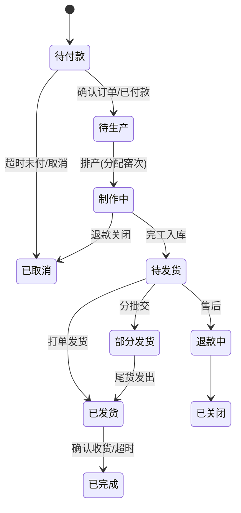

# 放心预 ERP 功能蓝图

> 定位：面向景德镇陶瓷直播电商的**轻量预售型 ERP**，替代聚水潭。
> 依据：启航电商 OMS（`zeasin/qihang-oms`，Apache-2.0）扒下来的行业标准设计 + 陶瓷预售场景改造。
> 状态：草案 v1 —— 定方向用，写代码前的施工图纸。

---

## 0. 一句话定位

聚水潭是给服装快消做的通用电商 ERP，**下单即有货、当天打单**；陶瓷是**下单才生产、交期按月算、一件一物**。

放心预 = 陶瓷直播间的「订单聚合 + 预售生产进度 + 打单发货 + 售后」，砍掉聚水潭 80% 陶瓷用不上的功能（WMS/PDA/财务对账），把价格压到它的零头。

---

## 1. 从启航 OMS 抄到的三样硬货（行业标准）

### 1.1 标准订单状态机

```
0 新订单 → 21 待付款 → 1 待发货 → 101 部分发货 → 2 已发货 → 3 已完成
                          ├─ 11 已取消
                          ├─ 12 退款中
                          ├─ 13 已关闭
                          └─ 22 已锁定
```

这是国内电商 ERP 的通用状态机，淘宝/抖店/拼多多/快手/视频号/小红书通用（启航的 `EnumShopType` 枚举了全部 8 个平台）。

**关键发现：启航这套状态机里根本没有「待生产」状态**——因为它假设下单即有库存。这正是陶瓷要突破的点。

### 1.2 核心数据模型（扒到的实体字段）

| 模块 | 表 | 关键字段 |
|---|---|---|
| 店铺 | o_shop | 名称、平台类型、appKey/appSecret/accessToken（印证「官方 API 需授权」门槛）|
| 商品 | o_goods | 名称、图、分类、品牌、重量/长宽高、采购价/零售价 |
| SKU | o_goods_sku | 颜色/尺寸/款式三组规格、条码、成本价、**库存预警阈值 lowQty** |
| 订单 | o_order | 订单号、店铺、状态、金额拆分（商品额/邮费/实付/改价/平台优惠/商家实收）、收货人姓名/手机/省市区/地址、下单时间 |
| 订单明细 | o_order_item | 关联 SKU、商品标题/图/货号/规格、单价/金额、数量、退款状态、发货人 |
| 发货 | o_shipment | 物流公司代码、运单号、运费、发货时间、包裹重量/长宽高 |
| 发货明细 | o_shipment_item | 哪个订单的哪个 SKU 发了多少（**支持部分发货**）|
| 售后 | o_after_sale | 售后类型、关联订单/明细/SKU、数量、退货物流、换货 SKU |
| 退款 | o_refund | 退款金额、原因、退货物流、平台状态 |

### 1.3 功能清单（启航 OMS 全模块）

商品库 / SKU / 分类属性 / 品牌 / 店铺管理 / 订单库 / 店铺订单 / 发货管理 / 电子面单 / 备货出库 / 售后 / 库存 / 采购 / 供应商 / 报表。

我们**不需要全部**，陶瓷场景只用其中 6 个（见下）。

---

## 2. 放心预 ERP 完整架构

### 2.1 订单状态机（陶瓷预售扩展版）

在标准状态机的「待付款 → 待发货」之间，**插入生产环节**——这是放心预唯一的、也是最关键的差异化：



状态码沿用启航体系，加两个陶瓷专属态：

| 码 | 状态 | 说明 | 来源 |
|---|---|---|---|
| 21 | 待付款 | CSV 导入进来的初始态 | 启航 |
| 0 | 待确认 | 客服核对地址/规格/定制要求 | 启航「新订单」 |
| **30** | **待生产** | 已付款，进入生产队列，未排产 | **陶瓷新增** |
| **31** | **制作中** | 拉坯/上釉/烧窑，跟踪进度 | **陶瓷新增** |
| 1 | 待发货 | 完工入库，等打单 | 启航 |
| 101 | 部分发货 | 多窑次分批交 | 启航 |
| 2 | 已发货 | 已填运单号 | 启航 |
| 3 | 已完成 | 收货/超时自动完成 | 启航 |
| 11/12/13 | 取消/退款中/关闭 | 异常分支 | 启航 |

**交期管理**（陶瓷命门）：每个订单带 `预计交期`，状态停在 30/31 时按交期倒计时，逾期自动标红 + 提示——这是聚水潭完全没有、但陶瓷商家天天焦虑的东西。

### 2.2 功能模块总览（对照现状）

| # | 模块 | 现状 | 优先级 | 说明 |
|---|---|---|---|---|
| 1 | **订单聚合** | ✅ 已有 | P0 打磨 | 全平台 CSV 导入 + AI 识别列名 + 去重，这是入口 |
| 2 | **订单管理** | ✅ 已有 | P0 补状态机 | 换成上面的预售状态机，加筛选/批量改状态 |
| 3 | **预售生产进度** | ❌ 缺 | **P0 核心** | 待生产/制作中/窑次/进度/交期预警 |
| 4 | **发货管理** | ❌ 缺 | P0 | 手动填单号 + 批量发货 + 物流跟踪（免费查询 API）|
| 5 | **售后台账** | ❌ 缺 | P1 | 退款/换货/补发，关联订单 |
| 6 | **商品/SKU** | ✅ 已有 | P1 补规格 | 加「釉色/窑次/泥料」陶瓷规格维度 |
| 7 | **库存 + 预警** | ❌ 缺 | P1 | 成品库存 + 低库存预警（陶瓷防超卖）|
| 8 | **经营报表** | 部分有 | P2 | 卖了/欠货/交期延误数/售后率 |
| — | 电子面单打印 | ❌ | **后置** | 有付费客户再接菜鸟/快递鸟 |
| — | 采购/供应商 | ❌ | 砍掉 | 陶瓷商家不用 |
| — | WMS/PDA 拣货 | ❌ | 砍掉 | 无大型仓库 |

> 关键：P0 的 4 个模块串起来就是「下单 → 生产 → 发货 → 售后」完整闭环，做完就是**能替代聚水潭的轻量 ERP**。

### 2.3 核心数据表设计（Supabase / Postgres）

沿用启航的字段命名和拆表逻辑，加陶瓷字段：

```
shops            店铺（名称、平台:抖店/快手/视频号/淘宝/拼多多、备注）
products         商品（名称、图、分类、重量、定价、成本）
product_skus     SKU（釉色/尺寸/窑次规格、条码、成本/售价、库存预警阈值）
orders           订单（订单号、店铺、状态码、收货人/地址/电话、
                  商品额/邮费/实付、下单时间、★预计交期、★定制备注）
order_items      明细（SKU、数量、单价、退款状态、★生产进度）
production_tasks 生产任务（★陶瓷特有：订单→排产→窑次→阶段:拉坯/上釉/烧窑/完工）
shipments        发货（物流公司、运单号、运费、发货时间）
shipment_items   发货明细（订单/SKU/数量，支持部分发货）
after_sales      售后（类型:退款/换货/补发、退货物流、状态）
```

---

## 3. 与聚水潭的差异化（为什么陶瓷商家选我们）

| 维度 | 聚水潭 | 放心预 |
|---|---|---|
| 订单入口 | 官方 API 实时同步（需 AppKey 授权） | **CSV 导入 + AI 识别**（任何商家都能用）|
| 预售/生产 | 不支持（下单即有货逻辑） | **待生产/制作中/窑次/交期预警**（核心）|
| 价格 | 5888–16888/年 + 按单 0.03–0.2 元 | 目标几百元/年 |
| 上手 | 重，需培训 | 装上即用 |
| 数据 | 云端 SaaS | 本地 + Supabase 云端可选 |

---

## 4. 分阶段实施路径

- **阶段 A（P0，现在就做）**：订单状态机 + 预售生产进度 + 发货管理 + 物流跟踪。跑通「下单→生产→发货」闭环。
- **阶段 B（P1）**：售后台账 + 商品规格增强（釉色/窑次）+ 库存预警 + 报表。
- **阶段 C（P2 / 有客户后）**：电子面单打印、多店铺协作（云端）、官方 API 自动同步（需注册个体户/公司）。

---

## 5. 关键技术决策

| 决策点 | 结论 | 状态 |
|---|---|---|
| 订单入口 | CSV 导入 + AI 识别（不做 API 同步） | ✅ 已定 |
| 电子面单 | 后置到有付费客户 | ✅ 已定 |
| 数据库 | 本地 SQLite + Supabase 云端（现架构） | ✅ 已定 |
| 状态机 | 启航标准 + 陶瓷「待生产/制作中」 | ✅ 本蓝图 |
| 是否照搬启航代码 | 否，只抄设计，套 Python/CustomTkinter | ✅ 已定 |
